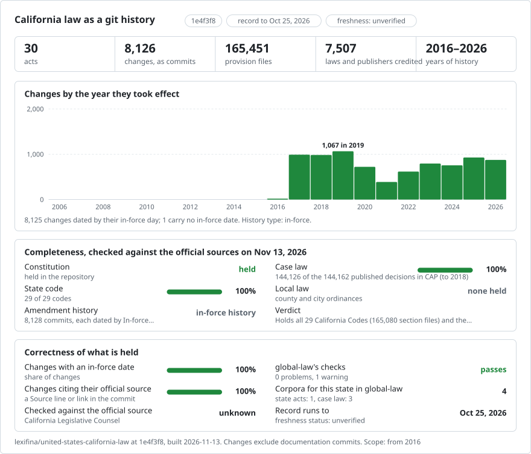

# Git for California law

<picture>
<source media="(prefers-color-scheme: dark)" srcset="data/effort-dark.svg">

</picture>

Part of [lexifina/global-law](https://github.com/lexifina/global-law), one git history for every country's law: this is the law of California, United States, which global-law reads at `united-states/california/statutes/`.

The text of the 29 California Codes and the California Constitution, section by section, with a commit for each
statute on each day its changes took effect, from 2016-11-27 to 2026-10-25. **Each commit is a statute taking
effect.** Its author is the statute that made the change (for example `Stats. 2019, ch. 115 (AB 1817)`), and its date is
the day the change came into force.

So the questions a lawyer asks of a code section become commands:

| The question | The command |
| --- | --- |
| What did Civil Code § 1714 say on 1 June 2020? | `python tools/ca.py on 2020-06-01 civ/1714.md` |
| Which statute wrote each subdivision? | `git blame civ/1714.md` |
| What changed between two dates? | `python tools/ca.py diff 2018-12-31 2024-12-31 civ/1714.md --words` |
| Everything one statute changed | `python tools/ca.py law "Stats. 2019, ch. 115"` |
| Every change to a section, with its dates | `python tools/ca.py log civ/1714.md` |
| The most amended sections of a code | `git log --format= --name-only -- veh \| sort \| uniq -c \| sort -rn \| head` |

`tools/ca.py` needs only Python 3 and git, and picks the text by each commit's `In-force:` date, so the answer does not
depend on your time zone or the time of day.

## What is here

165,451 section files in 30 folders (one per code, `cons/` for the Constitution), to 2026-10-25.
The original consolidated build contains 8,127 commits: 8,102 credited to a chaptered statute and 21 to a
ballot measure; the rest are the starting point, sections that ended by their own terms ("Repealed as of", "Inoperative"),
and differences between two of the Legislative Counsel's databases that no statute found explains.

Each section is one Markdown file, `<code>/<section>.md` (for example `civ/1714.md`, `pen/187.md`,
`cons/art-i/1.md`), with one paragraph or designated provision per line, indented by designation, so `git blame` names a
statute for every subdivision. Its last line is the section's history line from the Legislative Counsel's database, or,
for a version that only the chaptered bill preserves, the bill section it came from.

## How a change is dated and credited

The Legislative Counsel publishes its database as one archive per two-year session. Each archive has every code
section version in the database when it was made, with its effective date, the statute and chapter that made it, and
its history line. It does not keep superseded versions. This history combines six archives
(`pubinfo_2015.zip` of 2016-11-27, `pubinfo_2017.zip` of 2018-11-25, `pubinfo_2025.zip` of 2026-10-25) with the chaptered statutes in the same archives:

- **A version the database keeps** is dated by its operative date where the history line gives one ("Operative
  January 1, 2029, by its own provisions"), otherwise by its effective date, and credited to its statute.
- **A version that came and went between two archives** is taken from the chaptered statute that enacted it, which
  holds the full text of every section it adds or amends, dated by that statute's effective date (2,968 versions).
  The commit's `Date-basis:` trailer says how that date was found.
- **A repeal** is credited to the statute that repealed the section, by name or as part of a repealed chapter or article
  (1,412 found). A section that ends by its own terms is committed on that day, credited to the statute
  that set the term.
- **A section that is simply gone** from the next archive, with no repealing statute found, is a commit of its own,
  "Legislative Counsel database differs", dated by that archive.

Commits are dated at noon UTC.

## What it does not show

- **Before 2016-11-27.** The history starts from the database of that day; earlier versions are not here.
- **Future versions.** A version enacted to become operative after 2026-10-25 is not on `main`.
- **Uncodified law.** Statutes that do not amend a code (budget acts, uncodified sections) are not here.
- **Operative dates written only in the text.** A version taken from a chaptered bill is dated by the statute's
  effective date; if its own text defers its operation, the history does not know.
- **Alternative versions.** Where a statute holds two versions of one section (SEC. 1 and SEC. 1.5, one operative only if
  another bill is enacted) and the database keeps neither, neither is used (421 cases, listed in
  `build/NOT-USED.md`).
- **Annotations.** No notes of decisions, cross-references or editorial notes: statute text and the history line only.
- **Official status.** The Legislative Counsel's database is not the official publication of the statutes. For anything
  that matters, read the chaptered statute.

## Sources and reproducibility

The Legislative Counsel’s bulk database at https://downloads.leginfo.legislature.ca.gov/ supplies the code sections and chaptered statutes. The source archive checksums are in `build/DATA-SHA256SUMS`. [REPRODUCE.md](REPRODUCE.md) identifies the original editions and [CHANGES.md](CHANGES.md) records updates to the consolidated history.

Lexifina keeps a history of the US Code in the same form, [lexifina/united-states-law](https://github.com/lexifina/united-states-law),
and both are part of [lexifina/global-law](https://github.com/lexifina/global-law).

Built by [Lexifina](https://lexifina.com). For corrections, open an issue.

## License

The California Codes and Constitution are in the public domain: Government Code § 10248.5 says the information the
Legislative Counsel makes available under § 10248 "is within the public domain and the State of California retains no
copyright or other proprietary interest in that information." The history, commit messages, tools and documentation are
released under [CC BY 4.0](LICENSE.md).

## Earlier session laws, as enacted

20,456 historical chaptered statutes from the 1989–1990 through 2013–2014 sessions are preserved under `session-laws/<year>/chapter-<number>/law.md` (extraordinary sessions use `ex-<session>-chapter-<number>`). These are the complete normative bodies of the chaptered statutes, as enacted, from the Legislative Counsel’s prior-session archives. They are separate from the consolidated code history, which still begins on 2016-11-27. They do not establish every code section’s text on an earlier day.

Each added statute has a labelled correction commit with its effective date and source. Immediate-effect statutes use their official filing date; eligible regular-session statutes use Government Code § 9600(a), whose source history records its last amendment as Stats. 1973, ch. 7. Special-session statutes without an explicit immediate-effect clause, possible commencement exceptions, late enactments, missing text and normative images remain held. The published history is preserved.

| Session | Chaptered statutes listed | Added | Held |
| --- | ---: | ---: | ---: |
| 1989–1990 | 3207 | 2882 | 325 |
| 1991–1992 | 2621 | 1878 | 743 |
| 1993–1994 | 2652 | 1965 | 687 |
| 1995–1996 | 2167 | 1664 | 503 |
| 1997–1998 | 2037 | 1626 | 411 |
| 1999–2000 | 2112 | 1575 | 537 |
| 2001–2002 | 2149 | 1541 | 608 |
| 2003–2004 | 1874 | 1502 | 372 |
| 2005–2006 | 1638 | 1262 | 376 |
| 2007–2008 | 1524 | 978 | 546 |
| 2009–2010 | 1472 | 904 | 568 |
| 2011 (from the 2011–2012 archive) | 761 | 416 | 345 |
| 2012 (from the 2011–2012 archive) | 876 | 870 | 6 |
| 2013 (from the 2013–2014 archive) | 804 | 465 | 339 |
| 2014 (from the 2013–2014 archive) | 931 | 928 | 3 |

6,369 statutes remain held across these sessions. Their exclusion means this historical addition is partial. No earlier consolidated edition is claimed. Held earlier statutes and the pre-baseline portion of 2015–2016 remain outside this addition. The 2011 additions use the Legislative Counsel’s `pubinfo_2011.zip` archive: 117 immediate-effect statutes use their official filing dates, and 299 regular-session statutes use the January 1 commencement rule in Government Code § 9600(a). Special-session statutes, late or specific commencement cases, missing text and normative images remain held. The 2012 additions comprise 114 immediate-effect statutes dated by their official filing dates and 756 regular-session statutes dated January 1, 2013 under Government Code § 9600(a). Six 2012 image-bearing statutes remain held. The 2013 additions comprise 108 immediate-effect statutes dated by official filing dates and 357 regular statutes dated January 1, 2014. The 2014 additions comprise 118 immediate-effect statutes dated by official filing dates and 810 regular statutes dated January 1, 2015. Of the 2013 holds, 330 require specific commencement review, five are special-session statutes, and four contain normative images; three 2014 statutes contain normative images. These images have not been added to law text pending live asset support.

To read an enacted statute, open its `law.md` file or use `git show HEAD:session-laws/1989/chapter-1/law.md` with the appropriate year and chapter. `tools/ca.py` continues to read the consolidated code history.

AI assistance for this addition: GPT-6 wrote the deterministic collection and validation code. Every law word is copied from official XML; no model edited law text.
